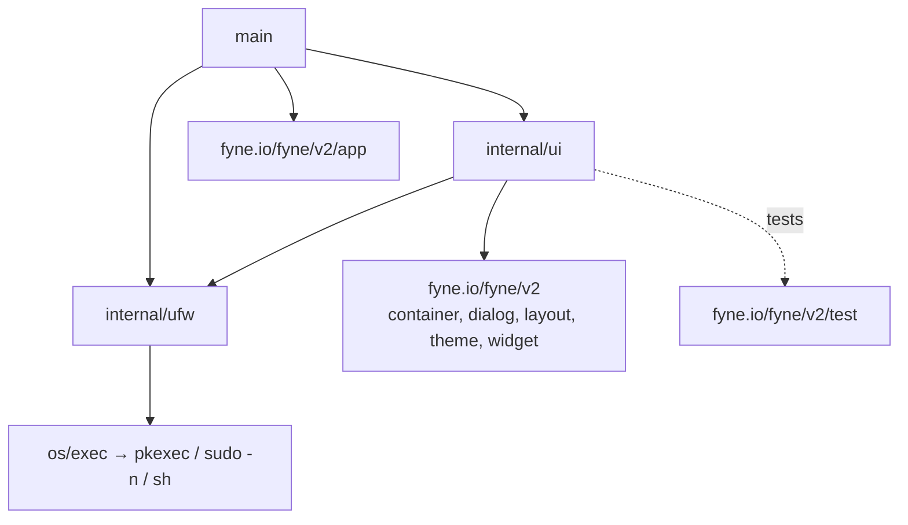

# CLAUDE.md

This file provides guidance to Claude Code (claude.ai/code) when working with code in this repository.

## Project

`ufwgui` is a Fyne desktop GUI for the Linux `ufw` firewall. It runs as a local application, shells out to `ufw`, `cat`, and `sh` via privilege escalation when needed, and makes no outbound network connections. Settings are stored in Fyne `Preferences` (app ID `local.ufwgui`); the command log exists only in memory.

The module name is `ufwgui` and the repo root is the Go module root. The project targets Go 1.27.2 as declared in `go.mod` and depends on Fyne v2.8.2 (the only direct dependency). If the installed Go is older, `GOTOOLCHAIN=auto` will fetch the required toolchain automatically. Keep indirect dependencies aligned with what Fyne requires; do not run `go get -u ./...` unless explicitly requested.

## Commands

Run from the repo root (where `go.mod` is):

```sh
go build -o ufwgui .            # needs cgo + Fyne deps on Linux: gcc libgl1-mesa-dev xorg-dev
go test ./...                   # all tests
go test ./internal/ufw -run TestStepsMove   # single test
go vet ./...
```

The UI test (`internal/ui/ui_test.go`) is headless through `fyne.io/fyne/v2/test` and does not run `ufw`. The app itself only works on Linux with `ufw` installed. `go test ./internal/ufw` is expected to pass on Windows because those tests only build and parse scripts; the GUI cannot be run against a real firewall there.

## Architecture

This repo is split into three layers: `main` bootstraps the app, `internal/ufw` owns the firewall execution/parsing logic, and `internal/ui` owns the Fyne UI and tab state. `main.go` creates the Fyne app (`app.NewWithID("local.ufwgui")`), picks `PrivNone` when the process runs as root (`os.Geteuid() == 0`) and otherwise `PrivPkexec`, then calls `ui.New(a, priv).ShowAndRun()`. A privilege stored in Preferences overrides that default.

Package import diagram (internal packages and direct external imports):



`internal/ufw` imports only the standard library and must stay free of UI code. `internal/ui` is the only package that depends on `internal/ufw` types besides `main`.

### File map

| File | Contents |
|---|---|
| `main.go` | Entry point, default privilege selection |
| `internal/ufw/runner.go` | `Privilege`, `Step`, `Cond`, `Result`, `LogEntry`, `Runner`, `ErrAuth`, `ShellQuote`, `CommandString`, script build/parse |
| `internal/ufw/ops.go` | Allowed values (`Actions`, `Policies`, `PolicyDirs`, `AppPolicies`, `LogLevels`, `RuleLogOptions`, `Protocols`, `Reports`), `StepsDeleteNumber`, `StepsMove`, `StepsReplace`, `SnapshotSteps`, `ErrNotMovable` |
| `internal/ufw/snapshot.go` | `Snapshot`, `AppProfile`, `ParseSnapshot`, `ParseAppList`, `ParseAppInfo`, `ListeningEntry`, `ParseListening`, `ParseAdded` |
| `internal/ufw/rules.go` | `Tuple`, `ParseTuples`/`ParseTuple`, `Tuple.Args`, `Rule`, `ParseNumbered`, `MergeRules` |
| `internal/ufw/ufw_test.go` | Tuple/numbered parsing, `Args`, `StepsMove`, script round-trip, app/report parsers |
| `internal/ui/app.go` | `App`, preference keys, `run`, `reportResult`, `refresh`, shared dialog helpers (`showOutput`, `showText`, `confirm`, `monoLabel`) |
| `internal/ui/overview.go` | `overviewTab` ("Status & Policies"): enable/disable/reload/reset, default policies, logging |
| `internal/ui/rules.go` | `rulesTab`: rule table, add/insert/prepend/edit/delete, move top/up/down/bottom/to |
| `internal/ui/ruledialog.go` | `ruleForm` rule builder (`showRuleDialog`), `placement` enum, `showForm` |
| `internal/ui/apps.go` | `appsTab` ("Application Profiles"): quick rules, app info/update, app default policy |
| `internal/ui/reports.go` | `reportsTab`: `ufw show …` / `ufw status …` with table views for `listening` and `added` |
| `internal/ui/logs.go` | `logTab` ("Command Log"), in-memory |
| `internal/ui/settings.go` | `settingsTab`: ufw path and privilege mode |
| `internal/ui/sorttable.go` | `SortTable`, `Column`, `naturalLess` |
| `internal/ui/ui_test.go` | Headless UI test, `naturalLess`, `unquoteArgs` |

### `internal/ufw` — command execution and parsing (no UI)

- **Runner (`runner.go`)**: every user action is a `Run(ctx, label, steps...)` call. All `Step`s from one call are compiled into a single `/bin/sh -c` script wrapped by `pkexec` (`PrivPkexec`), `sudo -n` (`PrivSudo`), or nothing (`PrivNone`), so the user authenticates at most once per action. The script forces `LC_ALL=C` and a sane `PATH` so output is parseable. Each step's output is bracketed by nonce markers (`@@<nonce>:BEGIN:i@@` / `END:i:<code>`) and parsed back into per-step `Result`s; steps that did not run have `Skipped=true, ExitCode=-1`. The script always exits 0, so a non-zero process exit means the elevation wrapper failed and should be treated as `ErrAuth`.
  - `UfwPath`, `Privilege`, and `DryRun` are guarded by a mutex: change them via `SetConfig` and read dry-run via `IsDryRun`.
  - `Ufw(mutating, args...)` is the helper for building ufw steps.
  - `Step.Mutating` controls whether `--dry-run` is prepended when dry-run mode is enabled; read-only commands must set this to `false`. `--dry-run` is only ever applied to ufw steps (`Prog == ""`).
  - `Step.RunIf` (`Cond`) makes a step conditional on an earlier step's success (`OK: true`) or on it having run and failed (`OK: false`) in the same script; this is how rollback is handled.
  - `Step.Prog` is empty when the command should target the configured `ufw` path; otherwise it can point to another program such as `cat` when reading files.
  - Arguments are quoted with `ShellQuote`; never build shell strings by hand. `CommandString` renders a display command line (ufw steps are shown as `ufw …` regardless of the configured path).
  - `OnLog` is called after every `Run` with a `LogEntry`; it runs on the calling goroutine.
- **Snapshot (`snapshot.go`, `ops.go:SnapshotSteps`)**: a refresh runs a fixed sequence of steps; `ParseSnapshot` reads results by index:
  `0` version · `1` status verbose · `2` status numbered · `3` `cat /etc/ufw/user.rules` · `4` `cat /etc/ufw/user6.rules` · `5` `cat /etc/default/ufw` · `6` `cat /etc/ufw/ufw.conf` · `7` app list · `8` app info all.
  Changing `SnapshotSteps` requires updating these indexes in `ParseSnapshot`. Values from the config files (`/etc/default/ufw`, `ufw.conf`) override what `status verbose` reports. Non-fatal problems are added to `Snapshot.Warnings` and surfaced through the Warnings button.
- **Report parsers (`snapshot.go`)**: `ParseListening` and `ParseAdded` are not part of the snapshot; they are used on demand by the Reports tab.
- **Rules (`rules.go`)**: `Tuple` is parsed from `### tuple ###` lines in the user rules files and is the authoritative rule definition (comments are hex-encoded there). `Tuple.Args()` regenerates full-syntax `ufw` CLI arguments with explicit addresses so a rule stays in its IP family. `Rule` is one numbered rule; `Rule.Tuple` is nil when the rule files were unreadable. `MergeRules` keeps tuple order (all IPv4, then all IPv6) as the numbering and uses display strings from `ufw status numbered` when number and family line up, otherwise synthesizes them. If the rule files cannot be read (`TuplesOK=false`), rules come from status output alone and move/edit is disabled.
- **Move/edit (`ops.go`)**: `ufw` has no move command. `StepsMove` and `StepsReplace` (both via `stepsMoveReplace`) emit `--force delete N`, then `insert M <args>` (or plain append when `M` is the family's last position) only if the delete succeeded, then reinsert the original at `N` only if the insert failed. Moves are restricted to the rule's own IP family (`familyBounds`).

### `internal/ui` — Fyne UI

- `App` (`app.go`) owns the window, the shared `*ufw.Runner`, the current `*ufw.Snapshot`, the toolbar (Refresh, Dry-run check, Warnings), and the status bar with a busy indicator. Tabs are structs (`overviewTab`, `rulesTab`, `appsTab`, `reportsTab`, `logTab`, `settingsTab`) constructed by `newXxxTab(a)`, each exposing a `content fyne.CanvasObject`. `logTab` is created first so `Runner.OnLog` is wired before any command runs.
- `refresh()` runs `SnapshotSteps` through `a.run` and calls `update(snap)` on `overviewTab`, `rulesTab`, and `appsTab` only; `reportsTab`, `logTab`, and `settingsTab` have no `update`.
- All commands go through `a.run(label, steps, refresh, done)`: they execute in a goroutine with a 5-minute timeout, marshal back to the UI thread via `fyne.Do`, and default to reporting via `reportResult` (errors, failed steps, and dry-run output in a dialog; success in the status bar). Pass `refresh=true` after mutations to reload the snapshot. Any UI mutation from a background goroutine must be marshaled through `fyne.Do` (including the `OnLog` callback).
- Rule builder (`ruledialog.go`): `showRuleDialog(a, placement, editing, target)` builds a `ruleForm` with Simple/Full syntax, live command preview, "Test (dry run)" (forces `--dry-run` for that call only by rewriting the steps and clearing `Mutating`), and "Delete matching rule". `placeReplace` edits an existing rule through `ufw.StepsReplace`.
- Settings such as the `ufw` path, privilege mode, and dry-run flag persist through Fyne `Preferences` (keys `prefUfwPath`, `prefPrivilege`, `prefDryRun` in `app.go`).
- `SortTable` (`sorttable.go`) is the shared sortable table used by the Rules, Apps, Reports, and Command Log tabs. Clicking a header cycles asc → desc → natural order, using `naturalLess` (case-insensitive, numeric-aware). Selection is tracked by data row, not view row. Rule movement in the Rules tab is only allowed while `IsNaturalOrder()` is true.
- `ui_test.go` reaches into unexported fields (`a.overview.policy`, `rulesTab.upBtn`/`downBtn`, `ruleForm.preview`, `appsTab.actionBtns`, …); renaming them breaks the test.


### Naming conventions

- Package names are lower-case and generally concise nouns or domain names: `ufw`, `ui`.
- Go source files use lowercase, descriptive names (`runner.go`, `snapshot.go`, `rules.go`, `ruledialog.go`, `sorttable.go`); UI tab files are named after the tab (`overview.go`, `apps.go`, `reports.go`, `logs.go`, `settings.go`). Test files use the `_test.go` suffix, one per package (`ufw_test.go`, `ui_test.go`).
- Exported types and functions use PascalCase (`Runner`, `Snapshot`, `Tuple`, `App`, `New`, `NewRunner`, `ParseSnapshot`, `SortTable`, `NewSortTable`).
- Unexported helpers and variables use lowerCamelCase (`newRulesTab`, `buildScript`, `parseScriptOutput`, `reportResult`, `cycleSort`, `naturalLess`).
- Parsers of ufw output or files are named `ParseXxx` (`ParseTuples`, `ParseNumbered`, `ParseAppInfo`, `ParseListening`); step builders are named `StepsXxx` (`StepsMove`, `StepsReplace`, `StepsDeleteNumber`, `SnapshotSteps`).
- Enum-like constants use a shared prefix: `PrivNone`/`PrivPkexec`/`PrivSudo`, `placeAppend`/`placeInsert`/`placePrepend`/`placeReplace`, `prefUfwPath`/`prefPrivilege`/`prefDryRun`, `kindNone`/`kindPort`/`kindApp`, `syntaxSimple`/`syntaxFull`. Sentinel errors use `ErrXxx` (`ErrAuth`, `ErrNotMovable`).
- Tab types are `xxxTab` with constructor `newXxxTab(a *App)`, a `content` field, and `update(*ufw.Snapshot)` when they reflect snapshot state.
- Rule and state names should stay aligned with the domain model: `Tuple`, `Snapshot`, `Runner`, `Result`, `Step`, and tab names reflect the underlying firewall workflow rather than generic UI terms.
- Prefer clear, action-oriented names for commands and steps, and keep private state and helper functions close to the type or file that owns them.

## Working constraints

- Keep changes focused and minimal.
- Prefer small, readable changes that match the existing structure, especially around shell quoting, command execution, and Fyne UI threading.
- Do not change behavior without a clear root cause and a targeted fix.
- When a bug or change touches both `internal/ufw` and `internal/ui`, confirm the contract between them before editing.
- Treat firewall commands as privileged operations and validate the script structure before broadening the behavior of `Runner` or `Step`.
- `rulesTab.familyBounds` duplicates `ufw.familyBounds`; keep their semantics in sync if either changes.

## Rules

- Include a dependency diagram. When updating this file, keep the package import diagram under Architecture and redraw it whenever a package is added or removed or the imports between packages change.
- Always update the Architecture section when `CLAUDE.md` is changed.
- Always include naming conventions.
- Always run unit tests if they exist.
- Never make changes that break the unit tests.
- Never implement changes when asked to show an example.
- Never implement changes when asked to make a suggestion.
- Always ask for permission before adding new packages, files, or directories.
- Always ask for permission before modifying or moving code unless explicitly instructed to do so.
- Always ask for permission before removing packages or files, even when they appear unused.
- Always ask when adding a 3rd party module of framework which doesn't already exist in the project.
- Always use open source no cost modules and framework if they are needed.
- Never modify test cases; suggest changes instead of editing them.
- Never change files that are clearly manually maintained, such as `rest.http`, except for this file.
- Ignore everything related to ESP-IDF.
